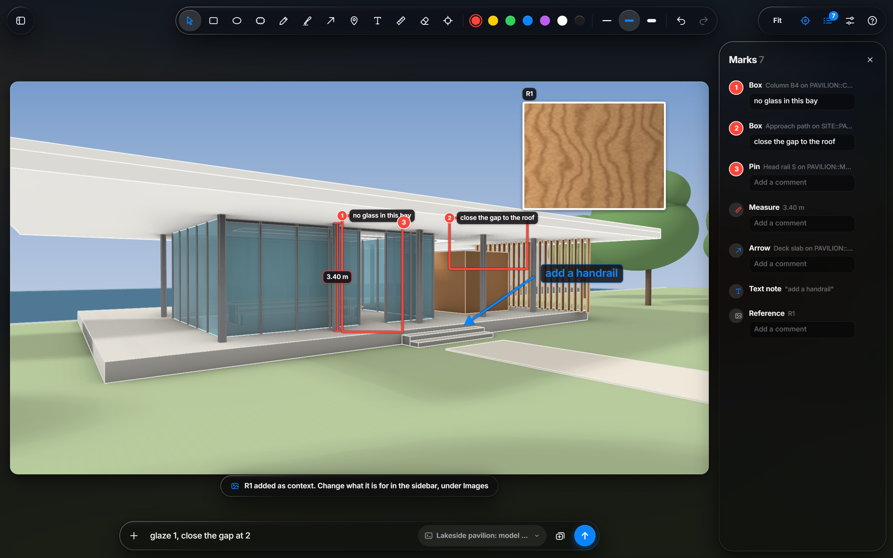
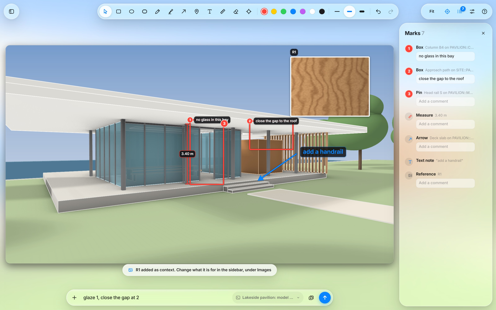
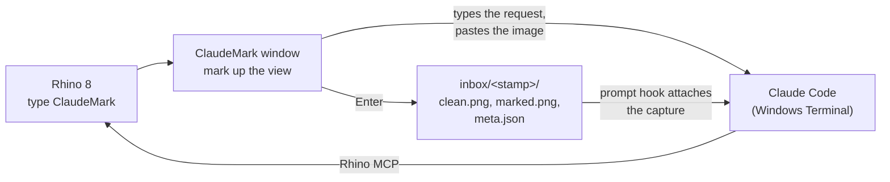
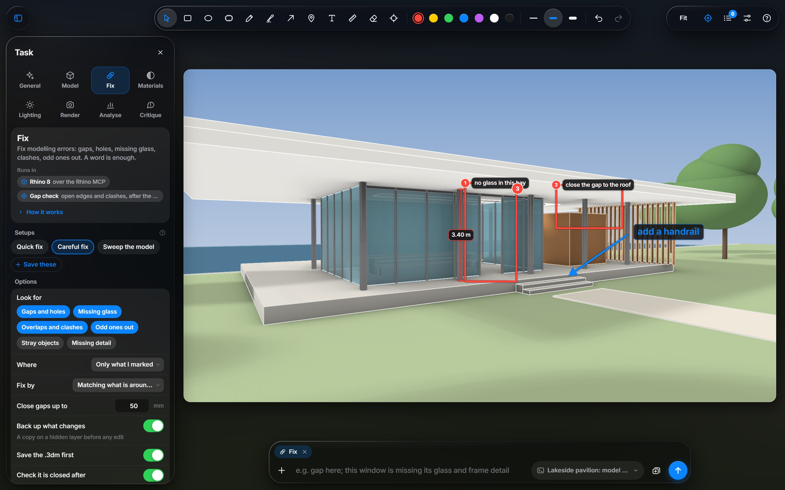
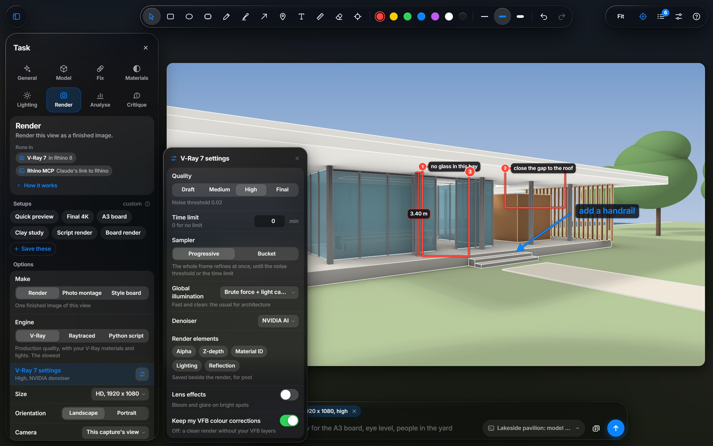
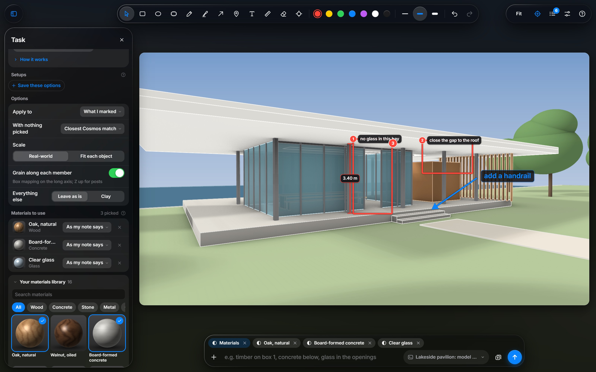
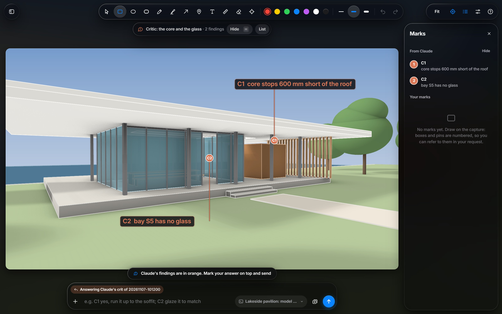
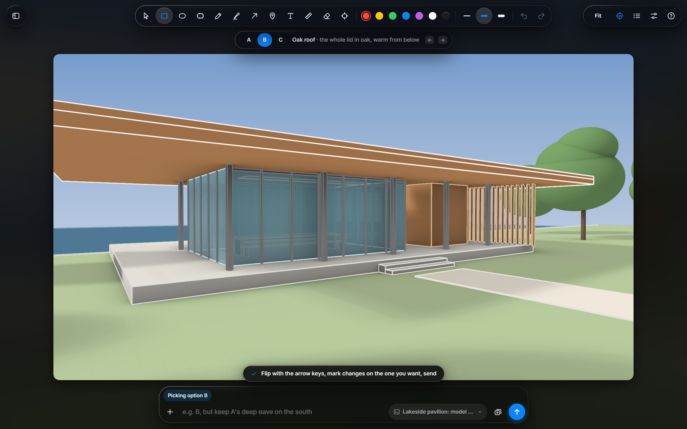
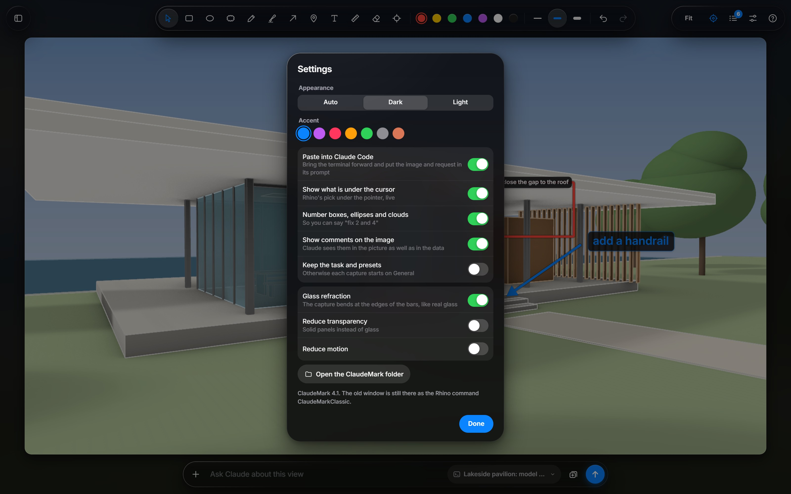

<p align="center">
  <a href="media/films/ClaudeMark-launch-16x9.mp4"></a>
</p>
<p align="center">
  <b>▶ <a href="media/films/ClaudeMark-launch-16x9.mp4">Watch the launch film</a></b> (90 s, with sound) · <a href="media/films/ClaudeMark-launch-9x16.mp4">vertical version</a>
</p>

# Rhino-ClaudeMark

**ClaudeMark** turns the Rhino view you are looking at into a request Claude can act on. Type `ClaudeMark` in Rhino and the view opens in a Liquid Glass window. Draw on it: numbered boxes, arrows, notes, real measurements. Pick the kind of job, type what you want, and press Enter. The marked image, the exact camera and what Rhino found under every mark go straight into Claude Code, which can then work in your model through the Rhino MCP.

No screenshots, no Downloads folder, no "the thing on the left".

| | |
|---|---|
|  |  |

## Contents

- [How it works](#how-it-works)
- [Features](#features)
- [Requirements](#requirements)
- [Installation](#installation)
- [Quick start with the demo pavilion](#quick-start-with-the-demo-pavilion)
- [Using ClaudeMark](#using-claudemark)
- [Keyboard shortcuts](#keyboard-shortcuts)
- [What Claude receives](#what-claude-receives)
- [Privacy and your data](#privacy-and-your-data)
- [Troubleshooting](#troubleshooting)
- [Try the window without Rhino](#try-the-window-without-rhino)
- [Updating and uninstalling](#updating-and-uninstalling)
- [What is in this repository](#what-is-in-this-repository)
- [Notes, credits and licence](#notes-credits-and-licence)

## How it works



1. **Capture.** `ClaudeMark` grabs the active viewport at its exact size, and records the camera (location, target, lens, the full world-to-screen matrix), the selection, active clipping planes, the document and the last lines of the command history. The camera is frozen while the window is open, so every mark lines up with the model.
2. **Mark.** You draw on the capture. Each mark asks Rhino what is under it, so "box 2" is tied to a named object on a named layer, not to a patch of pixels.
3. **Send.** Enter writes the capture to `inbox/<stamp>/` and types your request, with the marked image, into the Claude Code window you chose. You read it there and press Enter.
4. **Attach.** A small Claude Code hook sees the waiting capture when the prompt goes, attaches its folder (the clean and marked images and `meta.json`), and moves it to `sent/`.
5. **Act.** Claude reads the marks against the saved camera, works in the model through the Rhino MCP, checks the result from the same camera and tells you what changed. For crits and design options it can answer on your view, and `ClaudeReply` opens that answer in the same window.

## Features

- **One command.** `ClaudeMark` captures the active view with its camera, selection, clipping planes and layers.
- **Numbered marks.** Boxes, ellipses, revision clouds and pins count 1, 2, 3, so a request can say "fix 2 and 4". There is also a pen, a highlighter, arrows, text and an eraser.
- **Real measurements.** Drag between two points and Rhino picks the model under both ends: the label is the distance in model units (3.40 m), not pixels.
- **Every mark knows what is under it.** Rhino's own pick (object, name, layer) goes with each mark. Hover anything to see it live.
- **Comments on marks.** Double-click a mark and type; the comment is drawn beside its number and sent with it.
- **References.** Drop images from Explorer or a browser onto the spot they apply to. Each becomes a card (R1, R2) and says what it is for: a material to match, a look, a site photo for a montage. Photo match lines a site photo up with the model for montages.
- **Eight jobs.** General, Model, Fix, Materials, Lighting, Render, Analyse and Critique. Each says what it runs in and the steps Claude will take, and has its own options, saved setups and standing instructions. You can read the exact brief Claude will get before you send.
- **Straight into your session.** The request and the marked image are typed into the Claude Code window you pick by its session name.
- **Claude answers on your view.** Crits come back drawn on your capture (C1, C2) and design options come back as an A / B / C board you flip through and pick from.
- **Batches, drafts, light and dark.** Batch several views into one request. Every change is saved as a draft, so a crash loses nothing. Light or dark glass in your accent colour.

| | |
|---|---|
|  |  |
|  |  |
|  |  |

## Requirements

| You need | Why |
|---|---|
| **Windows 10 or 11** | The window is a WebView2 page and the paste uses Windows keyboard input. There is no Mac version. |
| **Rhino 8 for Windows** | `ClaudeMark` runs as a Rhino Python script. Built and tested on Rhino 8. |
| **Microsoft Edge WebView2 Runtime** | Draws the window. It ships with Windows 11 and comes with Microsoft Edge on Windows 10. Without it the older "classic" window opens instead. |
| **Claude Code**, running in **Windows Terminal** (or a classic console window) | Where your request goes. ClaudeMark finds Claude Code windows by their title. |
| **Python 3** on your PATH | Runs the small prompt hook that attaches captures. It uses only the standard library. |

Recommended and optional:

| Add | For |
|---|---|
| **A Rhino MCP server**, for example [`rhinomcp`](https://github.com/jingcheng-chen/rhinomcp) | So Claude can act in Rhino: fix, model, render, analyse. Without it Claude can still read your marks and answer, but cannot touch the model. |
| **V-Ray 7 for Rhino** | The Render and Lighting jobs, and V-Ray materials in the Materials job. Rhino's own Raytraced engine and a Python engine are offered too. |
| **Chaos Cosmos** downloads | Fill the materials and HDRI library in the sidebar. Your own `.vrmat` files and photos work as well. |
| `pip install numpy pillow opencv-python scipy` | The scripts in `tools/` that Claude runs for the Analyse, Critique and photo-montage jobs. |
| `pip install rhino3dm moderngl` | The "Python script" render engine (linework, white model and shadows drawn on your GPU in about half a second). |
| **Blender 4.5** | Optional Cycles rendering through the Python engine. |
| **Google Chrome** | "Find examples" (Ctrl+F), which docks Chrome beside the window on Google Images. |

## Installation

Allow about ten minutes. The paths below assume you put the folder at `C:\Tools\Rhino-ClaudeMark`; use your own path wherever you see that one.

### 1. Get the files

Either clone the repository:

```powershell
git clone https://github.com/Zealous259/Rhino-ClaudeMark.git C:\Tools\Rhino-ClaudeMark
```

or download the ZIP from GitHub (Code > Download ZIP) and extract it to `C:\Tools\Rhino-ClaudeMark`.

The folder can live anywhere: every script finds it from its own location. Two things to avoid:

- **A folder that OneDrive keeps online only.** If it is inside OneDrive, right-click it and choose *Always keep on this device*. A cloud-only placeholder looks like an empty file to the window.
- **A directory junction or symlink to the folder.** WebView2 will not serve files through one. Use the real folder.

### 2. Check WebView2 and Python

- **WebView2:** open *Settings > Apps > Installed apps* and look for *Microsoft Edge WebView2 Runtime*. If it is missing, install the *Evergreen Runtime* from Microsoft's WebView2 download page.
- **Python:** in a terminal, run `python --version`. You want `Python 3.x`. If Windows opens the Microsoft Store instead, Python is not installed (the `python` command is only a Store shortcut): install it from python.org with *Add python.exe to PATH* ticked, or note the full path of your `python.exe` for step 4.

### 3. Add the Rhino commands

ClaudeMark is four Rhino aliases. The easy way is the setup script. In Rhino 8, paste this on the command line (with your path) and press Enter:

```
_-RunPythonScript "C:\Tools\Rhino-ClaudeMark\setup\add_rhino_aliases.py"
```

It adds `ClaudeMark`, `ClaudeReply`, `ClaudeMarkClassic` and `ClaudeReplyClassic`, pointing at this folder, and prints what it did. Run it again whenever you move the folder.

<details>
<summary>Or add them by hand</summary>

Open *Tools > Options > Aliases*, click *New* for each row, and type the alias and its macro exactly:

| Alias | Macro |
|---|---|
| `ClaudeMark` | `! _-RunPythonScript "C:\Tools\Rhino-ClaudeMark\claude_mark.py"` |
| `ClaudeReply` | `! _-RunPythonScript "C:\Tools\Rhino-ClaudeMark\claude_reply.py"` |
| `ClaudeMarkClassic` | `! _-RunPythonScript "C:\Tools\Rhino-ClaudeMark\classic\claude_mark.py"` |
| `ClaudeReplyClassic` | `! _-RunPythonScript "C:\Tools\Rhino-ClaudeMark\classic\claude_reply.py"` |

Keep the quotes: they make paths with spaces work.

</details>

### 4. Add the Claude Code hook

The hook attaches each capture to the next prompt you send. From the ClaudeMark folder, run:

```powershell
cd C:\Tools\Rhino-ClaudeMark
python setup\add_claude_hook.py --check     # shows the change, writes nothing
python setup\add_claude_hook.py             # adds it
```

It adds one `UserPromptSubmit` entry to `~/.claude/settings.json` (your user settings, so it works in every project), keeps everything else in the file, saves a backup as `settings.json.bak`, and does nothing if the hook is already there. If `python` is not on your PATH, give it the interpreter Claude Code should use:

```powershell
python setup\add_claude_hook.py --python "C:/Users/you/AppData/Local/Programs/Python/Python312/python.exe"
```

Then **restart Claude Code**. In a session, `/hooks` lists the hook under *UserPromptSubmit*.

<details>
<summary>Or edit settings.json by hand</summary>

Open `%USERPROFILE%\.claude\settings.json` and add the entry under `"hooks"` (create `"hooks"` if the file has none). Use forward slashes in the path:

```json
{
  "hooks": {
    "UserPromptSubmit": [
      {
        "hooks": [
          {
            "type": "command",
            "command": "python \"C:/Tools/Rhino-ClaudeMark/hook/rhino_markup_inbox.py\"",
            "timeout": 10
          }
        ]
      }
    ]
  }
}
```

If you already have `UserPromptSubmit` hooks, add the inner `{ "hooks": [...] }` object to the existing list instead.

</details>

### 5. Connect Claude to Rhino (recommended)

ClaudeMark tells Claude what you mean. To let Claude act on it in your model, Claude Code needs a Rhino MCP server. ClaudeMark's tools are written for [`rhinomcp`](https://github.com/jingcheng-chen/rhinomcp) (Rhino 8, MIT licence):

1. **The Rhino plug-in.** In Rhino, run `PackageManager`, search for `rhinomcp`, install it, and restart Rhino.
2. **The server.** In a terminal:

   ```powershell
   claude mcp add rhino --scope user -- uvx rhinomcp
   ```

   That needs [`uv`](https://docs.astral.sh/uv/). Without uv, `pip install rhinomcp` and register the `rhinomcp.exe` it installs by its full path instead of `uvx rhinomcp`.
3. **Start it.** In Rhino, type `mcpstart` (once per Rhino session). In Claude Code, `/mcp` should list `rhino` as connected.

Install only one Rhino MCP plug-in: two of them both register an `mcpstart` command and collide.

### 6. Optional extras

- **V-Ray 7** for the Render and Lighting jobs, and **Chaos Cosmos** downloads for the materials and HDRI library (ClaudeMark looks in `Documents\Chaos Cosmos\Packages`).
- **Python packages** for Claude's analysis scripts: `pip install numpy pillow opencv-python scipy`, and `pip install rhino3dm moderngl` for the Python render engine.

### 7. Check it works

1. In Rhino, open any model with something in view (or build the demo, below) and type `ClaudeMark`. The view should open in the glass window within a second or two.
2. Draw a box, type `test` in the request bar, and choose your Claude Code window on the terminal button beside it.
3. Press Enter. The window closes and the text and image appear in Claude Code's prompt. Press Enter there.
4. Claude should describe your box and what Rhino found under it. If it only sees the image, the hook is not loaded: see [Troubleshooting](#troubleshooting).

## Quick start with the demo pavilion

`demo/build_demo.py` builds the model from the launch film: a lakeside pavilion in millimetres with materials, a sun and four named views (Approach, Aerial, Deck, Lake). It has two faults left in on purpose:

1. the oak service core stops 600 mm short of the roof soffit;
2. pane S5 on the south face of the glass room is missing.

Build it in an empty model (*File > New*, any template), then run:

```
_-RunPythonScript "C:\Tools\Rhino-ClaudeMark\demo\build_demo.py"
```

It takes a few seconds and leaves you on the Approach view in Rendered mode. It refuses to run in a model that already has objects in it, so it can never touch your own work.

Then do what the film does:

1. Type `ClaudeMark`.
2. Press **B** and drag a box around the bay with no glass. It is numbered **1**. Drag another around the gap above the oak core: **2**.
3. Press **D** and drag from the foot of a column to its top. Rhino measures it on the model: **3.40 m**.
4. Double-click box 1 and type a comment, `no glass in this bay`.
5. Open the sidebar (top left) and pick **Fix**. Read *How it works* and *What Claude gets* to see what Claude will be told.
6. Type `glaze 1, close the gap at 2` and press **Enter**.
7. In Claude Code, check the prompt and press Enter. With the Rhino MCP connected, Claude can find both faults from your marks, add the pane, run the core up to the soffit, and check the result from your camera, as in the film.

## Using ClaudeMark

### The window

The capture fills the window and the controls float over it on glass:

- **Top centre:** the toolbar, with the marking tools, colours, widths, undo and redo. Hover any button for its name and key.
- **Top left:** the sidebar button, which opens the job: what Claude should do, how, and with which options.
- **Top right:** Fit / 100 % zoom, the hover inspector (crosshair), the Marks list (with a count), Settings and Help (**?**, which lists every shortcut).
- **Bottom:** the request bar. **+** adds an image, or saves or copies the marked image. Then the request field, the terminal button (which Claude Code window gets the request), the batch button and Send.

### Marking tools

| Tool | Key | What it does |
|---|---|---|
| Select | V | Click a mark to move it, resize it from its handles, recolour it or change its width. A small bar offers Comment, Duplicate, Bring to front and Delete. Arrow keys nudge it. |
| Box | B | Drag over an area. Shift makes a square. Numbered. |
| Ellipse | O | Drag over an area. Shift makes a circle. Numbered. |
| Revision cloud | C | Drag over an area, drawn as a cloud. Numbered. |
| Pin | N | Click a point. Numbered. |
| Pen | P | Freehand. Hold Shift for a straight segment. |
| Highlighter | M | A wide, translucent marker. |
| Arrow | A | Drag from tail to tip. Shift snaps to 15 degrees. |
| Text | T | Click the spot it applies to and type. Enter finishes, Shift+Enter is a new line, Esc cancels. |
| Measure | D | Drag between two points on the model. The label is the real distance in model units. |
| Eraser | E | Rubs out pen and highlighter lines where it passes. Other marks are removed whole; references stay. |
| Photo match | Shift+M | For montages: pair points on a site photo with the same points on the model (below). |

Colours are **1** to **7**; **[** and **]** change the width. Right-click a mark, or the capture, for a menu.

### Numbers and comments

Boxes, ellipses, clouds and pins share one count, in the order you draw them. A deleted number is not reused, so "2" always means the same mark in your request. To add an instruction to a single mark, double-click it (or use its box in the Marks list) and type. The comment is drawn next to the number and sent with that mark.

### Measuring

Measure asks Rhino for the model point under each end and labels the true distance (633 mm, 4.21 m). In a parallel view, such as a plan or an elevation, an end that misses the model is measured on the view plane instead. The value, both world points and the method go to Claude, so "make this 3.6 m" is unambiguous.

### Seeing what is under a mark

- **Hover inspector** (crosshair, top right): shows Rhino's pick under the cursor, with the object type, name and layer.
- **Marks list** (top right): every mark with its number, what Rhino found under it, and a comment box.

Select objects in Rhino before you type `ClaudeMark` if the selection matters: it is recorded with the capture.

### Moving around the capture

Scroll (or Ctrl+scroll) zooms at the cursor. Space+drag or middle-drag pans. Ctrl+0 fits the capture, Ctrl+1 shows it at 100 %.

### References and photo match

Drag image files from Explorer, or images from a web page, onto the spot they apply to, or press Ctrl+V to paste a copied image. Each lands as a card (R1, R2...): drag it to move it, scroll over it to resize it. In the sidebar, under *Images on this capture*, say what each one is for: context, a precedent, a material, a light or a look to match, or the site photo for a montage. **Find examples** (Ctrl+F) docks Chrome beside the window on Google Images, so you can drag results straight in.

**Photo match** is for montages. Drop the site photo, double-click it to open it, and click points on it. Press Tab to go back to the model and click the same points in the same order: six or more, spread out, not all on one plane. Claude solves the camera from those pairs and places the model in the photo.

### Picking the job

The sidebar's eight tiles set the kind of job. Each one shows what it **runs in** and, under *How it works*, the steps Claude will take.

| Job | For | Runs in |
|---|---|---|
| **General** | Ask anything about this view, or have Claude change it. | Claude, plus the Rhino MCP if it needs to act |
| **Model** | Build or change geometry, to the level of detail you set: LOD 100 massing to LOD 400 fabrication, real components, blocks, Revit-style layers and names. | Rhino over the MCP |
| **Fix** | Modelling errors: gaps, holes, missing glass, clashes, odd ones out, stray objects. A one-word note is enough. | Rhino over the MCP |
| **Materials** | Put V-Ray materials on the surfaces you mark, from your library. | V-Ray in Rhino, over the MCP |
| **Lighting** | Sun and sky (time of day and season, or an exact date), an HDRI, a studio dome, or your own lights; exposure; a test render. | V-Ray in Rhino, over the MCP |
| **Render** | A finished image of this view, a photo montage or a style board, in V-Ray, Rhino's Raytraced, or a Python engine. | Your chosen engine |
| **Analyse** | A diagram out of the model: sections, sun hours, shadow studies, isovists, eye-level views. | ClaudeMark's tools in Rhino, drawn by `tools/cm_post.py` |
| **Critique** | A crit marked on your view: from Claude against your project brief, or from your own critic and council agents if you have them in Claude Code (they are not part of this repository). | Claude; findings come back through ClaudeReply |

Under the tiles:

- **Setups:** saved sets of options. Click one to apply it; it stays lit while the options match. *Save these* keeps the current options under a name. Right-click your own to update, rename or delete it. Render comes with Quick preview, Final 4K, A3 board, Clay study and Instant look; Lighting with Golden hour, Midday, Overcast, Blue hour and Studio white; Model with Massing, Design model, Construction detail and Revit-grade; Fix with Quick fix, Careful fix and Sweep the model.
- **Options:** the controls for the job, remembered per job. *Reset* puts a job back to its defaults. An engine's own settings pop up beside the sidebar when you pick it.
- **Materials to use** (Materials) and the HDRI library (Lighting): your Cosmos downloads with their previews, plus your own `.vrmat` files and photos. Pick several, and send each to a numbered mark, the selection, everything else, or wherever your note says.
- **Images on this capture:** your references and what each is for. They belong to this request only.
- **Your instructions:** standing instructions for that kind of job, sent every time.
- **What Claude gets:** the exact brief your options make, word for word.

Each capture starts on General unless *Keep for the next capture* is on in Settings. Options and setups are remembered either way. The small **?** beside a section explains it.

### Sending

Type your request and press **Enter** (Shift+Enter for a new line; Up in an empty box brings back earlier requests). Then:

1. The window closes and the capture is written to `inbox/<stamp>/`.
2. ClaudeMark brings the Claude Code window named on the **terminal button** to the front, types your request and pastes the marked image (and any batched images, up to six) with Alt+V. It types only once that window is confirmed in front, so keys never land in another program.
3. The prompt is **left unsent**. Read it, add to it if you like, and press Enter in Claude Code.
4. The hook attaches the capture folder to that prompt and moves it to `sent/`.

The terminal button lists every Windows Terminal and console window by its title, which is the Claude Code session name, and remembers your choice. Choose **Don't paste** to skip the typing: the capture then waits in `inbox/` and is attached to the next prompt you send in any Claude Code session. Captures still waiting after six hours are moved to `stale/` instead of being attached.

### Batching several views

Press **Ctrl+Shift+Enter** (or the stack button) to keep this capture and go mark another view. Batched captures wait in `queue/`, so nothing goes out early. The next normal Send releases them all, oldest first, with your request.

### Drafts, undo and closing

Every change is saved as a draft while you work. If Rhino crashes or the window closes, the next `ClaudeMark` offers *Unsent markup from 14:32* with Restore. Drafts are kept for seven days. Undo is Ctrl+Z and redo Ctrl+Y. **Esc** steps back one level at a time (cancels a stroke, deselects, leaves photo mode) and asks before throwing marks away.

**Ctrl+S** saves the marked image as a PNG (the folder is remembered) and **Ctrl+C** copies it. After a send, the marked image is also left on the clipboard.

### Settings

The sliders button, top right: appearance (Auto, Dark or Light), accent colour, paste on or off, the hover pick, numbering, comments drawn on the image, keeping the job for the next capture, glass refraction, *Reduce transparency* and *Reduce motion*. Reduce motion skips the opening animation and the panel easing; Windows' own *Animation effects* switch also skips the opening animation.

### When Claude answers on your view: ClaudeReply

When Claude posts a crit (with `tools/cm_reply.py`), the next `ClaudeMark` shows a banner, *Claude replied to ...*, with Open and Dismiss. You can also type `ClaudeReply`. Claude's findings (C1, C2...) are drawn in orange on your capture and listed under *From Claude* in the Marks list; **H** hides them. Mark your answer on top and send it: it arrives tagged as a reply, with each of your marks related to the nearest finding.

**Options boards** and **render style boards** open the same way, with A / B / C along the top. The arrow keys or the letters flip between them, and the one showing when you send is the one you picked.

### Writing requests that work

- Refer to marks by number: "close the gap at 2", "glaze 1 and 3".
- Put instructions that apply to one spot in that mark's comment, and the overall request in the request bar.
- Measure what matters. A measured 3.40 m tells Claude the scale far better than a description does.
- Select the objects you mean before capturing; the selection is recorded.
- Say what each reference is for in the sidebar.
- Pick the job that matches. Fix and Model change geometry; General is for questions.
- Use *Your instructions* for rules you would otherwise repeat, such as "never touch the SITE layers".

## Keyboard shortcuts

| Action | Keys |
|---|---|
| Select, Box, Ellipse, Cloud, Pin | V, B, O, C, N |
| Pen, Highlighter, Arrow, Text, Measure, Eraser | P, M, A, T, D, E |
| Photo match | Shift+M |
| Colour | 1 to 7 |
| Thinner, thicker | [ and ] |
| Straight line, square or circle, 15 degree snap | Shift while drawing |
| Comment on a mark | Double-click |
| Delete the selected or hovered mark | Del |
| Nudge the selected mark | Arrow keys |
| Undo, redo | Ctrl+Z, Ctrl+Y |
| Clear all | Ctrl+Del |
| Zoom | Scroll or Ctrl+scroll |
| Fit, actual size | Ctrl+0, Ctrl+1 |
| Pan | Space+drag or middle-drag |
| Hide Claude's findings (ClaudeReply) | H |
| Send to Claude | Enter |
| New line in the request | Shift+Enter |
| Add to batch and keep going | Ctrl+Shift+Enter |
| Earlier requests | Up in an empty box |
| Paste an image as a reference | Ctrl+V |
| Save, copy the marked image | Ctrl+S, Ctrl+C |
| Find examples in Chrome | Ctrl+F |
| Step back, then close (asks first if you marked) | Esc |

## What Claude receives

Each send writes one folder, `inbox/<stamp>/`:

| File | What it is |
|---|---|
| `clean.png` | The capture, exactly viewport size |
| `marked.png` | The capture with your marks drawn in, rendered by the window itself, so it is exactly what you saw |
| `meta.json` | Everything else, recorded at the moment of capture |
| `refN.png` | Your references, at most 2000 px (a dropped file also keeps its full-resolution original) |

`meta.json` holds the camera (projection, location, target, lens, frustum and the 4x4 world-to-screen matrix), the document (path, units, object count, current layer), the view and display mode, the construction plane, the selection, active clipping planes, the last 15 command-history lines, your request, the job with its options and its brief, and every mark in image pixels with Rhino's hit under it (object id, type, name, layer and the 3D point). The full schema, every mark type and how to turn pixels back into world points are in [docs/MANUAL.md](docs/MANUAL.md#metajson).

The hook gives Claude a short guide with the folder: look at the marked image first, map pixels through the saved camera rather than the live view, treat marks as markup rather than geometry, and treat Rhino's picks as hints to verify.

## Privacy and your data

- ClaudeMark uploads nothing. It writes files in its own folder and types into the Claude Code window you choose. Its only network use is downloading an image you drop in from a web page, and opening Chrome when you use Find examples. What reaches Claude is what Claude Code sends: your prompt, the pasted image, and the capture folder the hook points it to.
- That folder includes your **document's file path**, layer and object names, and the **last 15 lines of Rhino's command history**, as well as the images. Do not send a capture of something you would not show Claude.
- Captures stay on disk after sending, in `sent/` (or `stale/`), with drafts in `inbox/.<stamp>/` for seven days. Delete those folders whenever you like.
- Settings and your saved setups live in `claudemark_settings.json` and `presets/`. Git ignores all of these, so they never end up in a commit.
- Prompts that start with `/` (slash commands) or `<` leave the inbox alone, so a capture is never attached to a command by accident.

## Troubleshooting

Start with `.cache/claudemark.log` in the ClaudeMark folder. It records start-up times, page errors and failures.

| Problem | What to do |
|---|---|
| `Unknown command: ClaudeMark` | The aliases are missing or point at an old path. Run `setup\add_rhino_aliases.py` again (step 3), or check *Tools > Options > Aliases*. |
| The older, plainer window opens instead | WebView2 could not start, or the page did not answer within 12 seconds; the reason is on Rhino's command line and in the log. Install or repair the WebView2 Runtime (step 2). |
| The window is blank or missing its styles | The folder is in OneDrive and some files are online only (choose *Always keep on this device*), or you opened it through a junction or symlink. |
| Nothing is typed into Claude Code | Pick the right window on the terminal button. Claude Code must be running in Windows Terminal or a console window; a terminal inside an editor is not in the list. Use *Don't paste* there and the hook still attaches the capture to your next prompt. |
| "The terminal did not come forward, so nothing was typed" | Windows refused to bring that window to the front. Click it once and send again, or use *Don't paste*. |
| Claude sees the image but not the marks, camera or picks | The hook is not running. Restart Claude Code after step 4, check `/hooks`, and check that the `python` in the hook command runs Python 3 (or re-run the setup with `--python`). |
| A capture turns up in the wrong session | Waiting captures are attached to the next prompt sent in **any** Claude Code session. Send right after capturing, or paste into the session you mean. |
| Claude says it cannot act in Rhino | The Rhino MCP is not connected: type `mcpstart` in Rhino and check `/mcp` in Claude Code (step 5). |
| Render or Lighting stops early | Those jobs drive V-Ray 7 for Rhino. Pick Rhino's Raytraced or the Python engine in the Render options if you do not have V-Ray. |
| An old capture is attached long after | It was waiting in `inbox/`. Anything older than six hours goes to `stale/` instead; delete what you do not want from `inbox/`. |

## Try the window without Rhino

The window runs in a browser against a stand-in for Rhino (`ui/mock.js`) and the demo capture in `mock/`. From the repository folder:

```powershell
python -m http.server 8765
```

Then open <http://127.0.0.1:8765/ui/index.html?mock=1&nopending=1>. Everything works except the parts that need Rhino: picks come from the demo's recorded object rectangles, and Send goes nowhere. Add `&scenario=marks` to start with one of every mark.

For development, `claude_mark.py` honours `CLAUDEMARK_TEST_ROOT` (a scratch copy of this folder with a real `ui/` folder) and `CLAUDEMARK_TEST` for scripted runs that never touch the real inbox, and `window.CMTest` in the page drives the real handlers. The hook honours `CLAUDEMARK_ROOT`. See [docs/MANUAL.md](docs/MANUAL.md#working-on-it).

## Updating and uninstalling

**Update:** `git pull` in the folder, or download the ZIP again and copy it over the old folder. Your captures, settings and setups are untouched, because they live in folders git ignores. If the folder moved, run both setup scripts again.

**Uninstall:**

1. In Rhino, *Tools > Options > Aliases*: delete `ClaudeMark`, `ClaudeReply`, `ClaudeMarkClassic` and `ClaudeReplyClassic`.
2. In `~/.claude/settings.json`, delete the `UserPromptSubmit` entry whose command ends in `rhino_markup_inbox.py` (the setup script left a backup as `settings.json.bak`).
3. Delete the ClaudeMark folder.

## What is in this repository

| Path | What |
|---|---|
| `claude_mark.py` | The Rhino side (IronPython, run by the `ClaudeMark` alias): capture, camera, picks, presets, send, paste and the window host |
| `claude_reply.py` | `ClaudeReply`: opens Claude's newest crit or options board |
| `ui/` | The window: a WebView2 page (`index.html`, `app.js`, `app.css`), the Inter font and `mock.js` for browser work |
| `hook/rhino_markup_inbox.py` | The Claude Code `UserPromptSubmit` hook that attaches waiting captures |
| `setup/` | `add_rhino_aliases.py` and `add_claude_hook.py` (installation steps 3 and 4) |
| `demo/build_demo.py` | Builds the demo pavilion from the film in an empty Rhino model |
| `tools/` | Claude's scripts for the Analyse, Critique and montage jobs; `tools/TOOLS.md` explains them |
| `notes/` | Rhino and V-Ray scripting notes that the job briefs point Claude to |
| `classic/` | The earlier window, kept as a fallback (`ClaudeMarkClassic`, `ClaudeReplyClassic`) |
| `mock/` | The demo capture and data for running the window in a browser |
| `media/` | The launch film (16:9 and 9:16), four demo clips, screenshots and the preview above |
| `docs/MANUAL.md` | The full manual: every option and the complete `meta.json` schema |
| `inbox/`, `queue/`, `outbox/`, `presets/` | Created and filled as you work; ignored by git |

## Notes, credits and licence

ClaudeMark is an independent project. It is not affiliated with or endorsed by Anthropic or Robert McNeel & Associates. Claude and Claude Code are trademarks of Anthropic; Rhino is a trademark of Robert McNeel & Associates.

The launch film drives the real ClaudeMark window. Its score is original and synthesised in code, its voice-over and sound effects were made with ElevenLabs, and every model, capture and material swatch in it is an original demo made for this project.

The window uses [Inter](https://rsms.me/inter/) under the SIL Open Font License (`ui/fonts/Inter-LICENSE.txt`).

No open-source licence has been chosen yet, so for now the code is the author's, all rights reserved.
